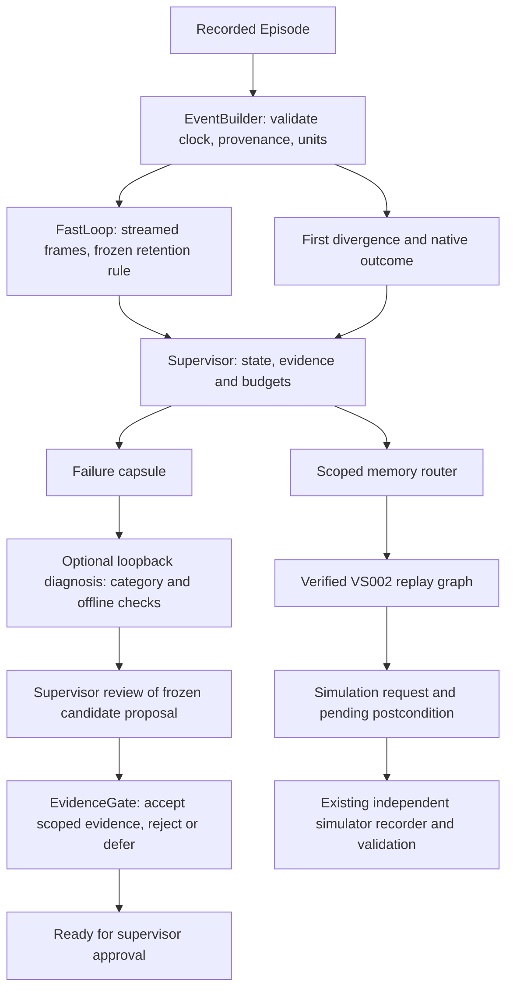
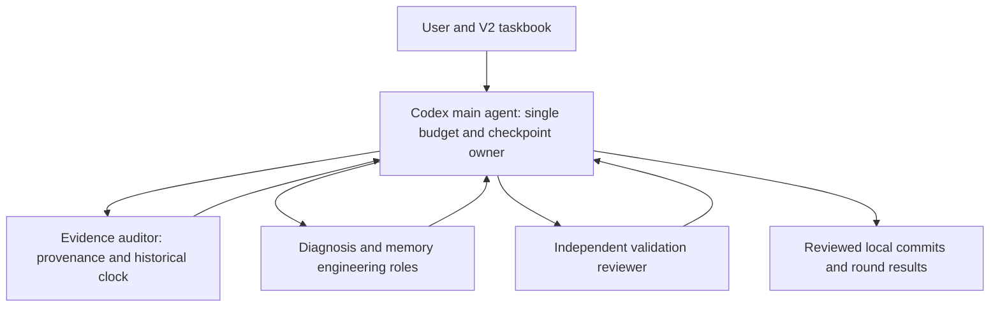

# Fast and slow diagnosis on recorded episodes

## Runtime

The CLI consumes stopped data. A validated simulation request stops at the graph's fresh-Episode postcondition. During the final paired collection the research supervisor invoked the existing simulator separately. Active policy selection and the native safety controller have separate ownership. Hardware execution is closed for this batch.

The resident fast path measures events, detects the earliest observed anomaly, routes a scoped skill, and holds on a missing postcondition. The slow path accepts only a hypothesis class and a short whitelist of ranked offline checks. World-model changes, policy changes, observation adapters, diagnostic rules and skills go through proposal review. An unsupported physical intervention returns defer or reject. The gate implemented here can accept the narrowly tested simulation-clock adapter. V2 has no automatic production deployment writer.

`robot_agent/supervisor.py` owns the decision trace and per-request budgets. The optional localhost model receives only the capsule and allowed diagnostic categories/checks. Pre-tokenization and capped completion constrain usage. Unknown usage after an interrupted request exhausts the remaining diagnostic budget. No model is required for replay. The optional provider follows the [llama.cpp server API](https://github.com/ggml-org/llama.cpp/tree/master/tools/server).

## Development

Only one scoped child worked at a time. The main agent implemented the runtime modules. The baseline auditor and final validation reviewer ran in fresh contexts. Four project role files support future bounded assignments and inherit the parent model. Read-only assignments are instructions to the child; the local client inherits its parent permissions. [Official Codex subagent documentation](https://learn.chatgpt.com/docs/agent-configuration/subagents)

The native probe exposes active constraints, geom distances and reconstructed scope through the existing MuJoCo adapter. The graph records preconditions and the pending postcondition in JSON. We used the RSS query design, GaP checkpoint idea and ASPIRE execution-trace approach. All raw files and simulator code stay at their existing locations. [RSS contact queries](https://github.com/robosimstudio/robosimstudio/blob/main/robosimstudio/core/probes/contact.py) · [GaP](https://github.com/graph-robots/graph-as-policy) · [ASPIRE](https://github.com/NVlabs/ASPIRE) · [MuJoCo contacts](https://mujoco.readthedocs.io/en/stable/computation/index.html#contact)
