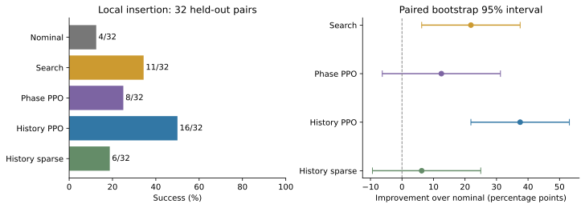
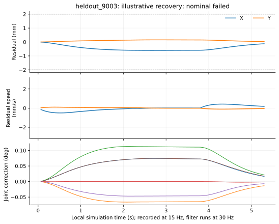

# MVP-B：局部几何恢复 GO；执行器扩展 INCONCLUSIVE

本报告只讨论 **Simulation-only** 的双臂模型/右臂局部插入任务。没有真实训练、真实执行、真实成功率或双臂协同声明。

## 第一阶段：冻结基准与配对结果

V1 nominal 原封不动：reference hash `a433cb513b9513e77badc8edd4b7de648e07f62286e8520c8a40d12d1dac7b18`。从最后一个 transport 状态（frame 441）开始，执行至退避结束（frame 600），完整局部时长 5.3 s。无扰动物理重放成功，策略采样点的完整积分状态误差为 0。原始整任务成功/完整 Episode 验证仍由 V1 证据支持；这里的训练与测试是局部 rollout，不能冒充新的完整任务 Episode。

Pilot 预声明 15 个条件、B0/B1 共 30 次物理执行。随后固定训练范围：socket XY 各 ±1 mm、手内 XY 各 ±0.1 mm、小 yaw ±0.5°。正式 held-out 为 1.15/1.3 mm socket 幅度、8 个方向、两组独立手内扰动；32 个条件在所有策略间配对。另有 20 个小手内扰动的 nominal 条件，避免把相同的确定性重复当独立样本。最终 checkpoint 固定，未按 held-out 结果挑选模型或调幅度。

| 策略 | held-out 成功 | 相对 Nominal 提升 / 95% CI（百分点） | 无扰动附近成功 |
|---|---:|---:|---:|
| Frozen Nominal | 4/32 | 0 [0, 0] | 20/20 |
| 确定性局部搜索 | 11/32 | 21.9 [6.25, 37.5] | 20/20 |
| Phase-Gated PPO（单帧） | 8/32 | 12.5 [-6.25, 31.2] | 20/20 |
| History PPO（0.5 s，结构化奖励） | 16/32 | 37.5 [21.9, 53.1] | 20/20 |
| History PPO（0.5 s，稀疏奖励） | 6/32 | 6.25 [-9.38, 25] | 20/20 |

History PPO 恢复了 Nominal 失败的 12/28 个条件（42.9%），没有破坏原来成功的 4 个条件。其 +37.5 个百分点的配对 bootstrap 区间 [21.875, 53.125] 支持本轮局部几何恢复 GO。与确定性搜索相比，提升为 +15.625 个百分点，区间 [-3.125, 34.375]；不能声称已证明优于搜索。每个训练配置只使用一个训练 seed，区间重采样的是测试条件，不代表跨训练初始化的稳定性。B2/B3 的训练 seed 不同，也不能把差异全部归因于 history。

## 控制接口与平滑性

Student 只接收右臂 6 个关节及夹爪的状态、速度、nominal action、命令/反馈差和 phase；B3 用 15 帧（约 0.5 s）历史。紧凑 MLP 为两层 64 单元，PPO 只训练 residual。输出为 XY，右臂 6 个关节通过固定参考姿态的运动学映射注入；左臂和夹爪命令保持 nominal。新修正只在 align/insert 接受；释放时保持最后的插入目标偏置，退避时平滑收回。这是明确的释放/退避过渡，不声称这些阶段的实际偏置瞬间为零。

使用解析二阶临界阻尼滤波器：每轴位置 ±2 mm、速度 ≤3 mm/s、加速度 ≤30 mm/s²，另有关节修正 ±0.03 rad 上限。292 个第一阶段评估 rollout 和 116 个执行器阶段 rollout 的动作审计全部通过；第一阶段记录到的最大每轴偏置 1.104 mm、速度 1.279 mm/s，执行器阶段分别为 0.630 mm、0.490 mm/s。30 Hz 滤波器的反向目标/随机目标测试验证速度和加速度约束；评估轨迹记录为 15 Hz，不能据此声称测得实机无抖动。成功 rollout 保持原生 5.3 s 时序。

## RGB dropout 与信息边界

B3 在 RGB dropout=0 和 dropout=1 时均为 16/32，32 条动作序列完全相同。这是有效的无视觉执行证据，但不能证明视觉融合有效：原始可选 RGB 分支在 1,404 次采样中没有提供可用配对特征，实际输入一直缺失。MVP-A 的联合关键点校准未通过，未把不可靠特征硬标为可信。

PPO 接收扁平观测数组，不持有 MuJoCo backend 或 MjData。额外干预 plug/socket 真值和原生 success hold counter 后，无视觉 Student 观测及动作保持逐值相同。独立运行时审计禁止打开 real/control/reference 数据目录或导入硬件驱动，测试执行通过。特权状态只用于 reset、reward、原生仿真安全检测、离线 evaluator 和记录；这不是操作系统沙箱的安全声明。

84 个不同条件在 nominal、单帧 policy、history/RGB policy 模式下，重置后的完整积分状态和 model body positions 哈希完全一致。1 mm socket 扰动使目标碰撞几何移动 1 mm，并改变 910 个 RGB 像素；质量、摩擦、solver 参数和成功阈值未改变。运行时实验夹具位移是预声明扰动，自动 Twin 更新、源资产修改均为 0。

## 第二阶段：延迟和夹爪状态

几何训练后才加入 0/1 个控制帧的右臂关节命令延迟、初始夹爪宽度 ±0.05 mm，使用固定 8,192 步 warm-start curriculum。测试改用另一组 32 个 seed、2 帧延迟（约 66.7 ms）及 ±0.075 mm 夹爪变化；未更改原第一阶段测试或冻结 nominal。

第二阶段 Nominal 为 6/32，未经额外训练的 History PPO 为 13/32，额外 curriculum 后为 7/32。新模型相对 Nominal 提升 +3.125 个百分点，95% CI [-15.625, 21.875]；它的 nominal 回归测试仍为 20/20。扩展训练未得到支持性结论，记为 **INCONCLUSIVE**，不能挑选旧模型的较高结果来宣称 curriculum 成功。本轮不继续训练、不改摩擦/成功阈值，也不进入真实迁移。

## 预算、诊断与限制

3 个第一阶段 PPO 配置各 16,384 步，第二阶段 8,192 步，共 57,344 步、696 个完整训练 rollout，另有各向量环境在固定预算末尾的未完成轨迹。原始动作/奖励/权重都留在 DATA_ROOT；Git 保存设计、统计、代码和哈希。完成时的源码哈希记录曾与运行期间的纯包装器演进混在一起；关键对照已在源码预先快照并推送后重复验证，旧运行保留，重复不增加统计样本数。B0 的两次 52 条结果在 outcome、碰撞、末态指标、时长和最大穿透上完全一致。全部训练源码快照和权重哈希均复核通过。

第一阶段 131 个失败 rollout 经停止后的 EventBuilder / FailureReport / Supervisor 形成离线 capsule，MemoryRouter 使用隔离实现；Slow/LLM 调用 0，legacy skill invocation 0，根因仍 UNKNOWN。没有结构更新提案或自动 Twin 修改。

本轮证明有限范围的 simulation residual viability；没有证明 Event-Gating 优于 Phase-Gating，没有跨训练 seed 的稳定性证明，没有真实训练或真实执行。
